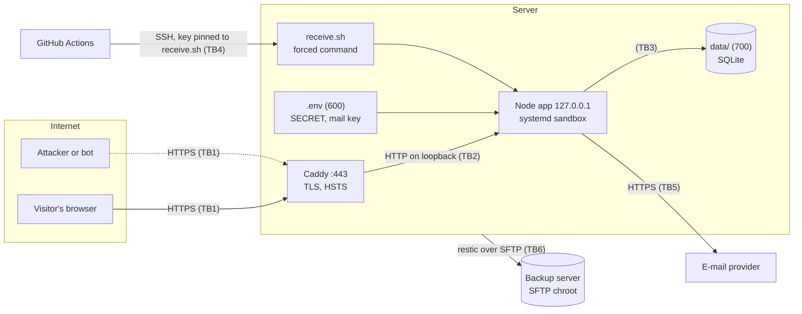

# Threat model

[Leia em português](THREAT-MODEL.pt-BR.md)

STRIDE, per element and trust boundary. Version 0.1.0, reviewed on 2026-10-30. Every mitigation names the file that
implements it; most of them also have a test that tries to break it (`test/`). What is not mitigated is said so, in
[Accepted risks](#6-accepted-risks).

## 1. The system

A small website on one Linux server: Caddy terminates TLS and proxies to a Node.js process on the loopback
interface. Node serves static pages and a JSON API (passwordless accounts and an admin endpoint) backed by one SQLite
file. GitHub Actions tests every change and, on `main`, delivers it over SSH. Backups go to GitHub (encrypted) or
to a second server (restic).

| Trust boundary | Between | What crosses it |
|---|---|---|
| TB1 | Internet and Caddy | every request, from anyone |
| TB2 | Caddy and Node | the same requests, with `X-Forwarded-For` added by Caddy |
| TB3 | Node and the operating system | file access, system calls; contained by systemd |
| TB4 | GitHub and the server | new versions of the code, backup reads |
| TB5 | Node and the e-mail provider | the address and the sign-in code |
| TB6 | Site server and backup server | encrypted backup data |

## 2. Assets

| ID | Asset | Why it matters |
|---|---|---|
| A1 | E-mail addresses of the accounts | personal data (LGPD, GDPR); the account identifier |
| A2 | Session tokens | whoever holds one is the user, for up to 30 days |
| A3 | Sign-in codes | a credential for 10 minutes |
| A4 | `SECRET` and the mail provider key | forge nothing by themselves, but weaken A3 and allow sending mail as the site |
| A5 | Integrity of the server | the code, and other sites that may share the machine |
| A6 | Backups | a full copy of A1 |
| A7 | Availability of sign-in | the busiest moment is also the most visible (a launch) |

## 3. Who might attack

- **Anonymous visitors and bots** on the internet: scanners, credential stuffing, spam, scraping.
- **A signed-in user** trying to reach someone else's data or the admin endpoint.
- **Someone with a copy of the database or a backup**: a stolen disk image, a leaked artifact.
- **Someone in the delivery chain**: a compromised action, package or GitHub token.
- **A neighbour**: another site on the same server that was compromised first.

## 4. STRIDE

### Spoofing

| ID | Threat | Mitigation | Status |
|---|---|---|---|
| S1 | Guessing someone's sign-in code | 6 digits (10⁶), 5 attempts per code, 5 codes an hour per e-mail and IP, 12 per e-mail in total, 150 code requests per IP per hour (`server/accounts.mjs`, `server/server.mjs`). At most 25 guesses per hour per address: ~40,000 hours for a 50% chance. | Mitigated, tested |
| S2 | Taking over the mailbox, and so the account | The mailbox is the only factor. | **Accepted**, see R-1 |
| S3 | Stealing the session through XSS | `HttpOnly` cookie; CSP without inline scripts or styles; Trusted Types; the front end only writes `textContent` (`server/http.mjs`, `public/js/app.js`). | Mitigated, tested in a browser |
| S4 | Stealing the session on the network | HTTPS only, HSTS, cookie `Secure` with the `__Host-` prefix. | Mitigated |
| S5 | Faking the client IP to dodge rate limits | Only the **last** `X-Forwarded-For` entry counts (the one Caddy appended), only when `TRUST_PROXY=1`; Node listens on 127.0.0.1; IPv6 counts per /64 (`server/http.mjs`). | Mitigated, tested |
| S6 | Impersonating the server to the deploy job (first SSH connection) | The server's host key is a secret saved at setup (`DEPLOY_KNOWN_HOSTS`), never `ssh-keyscan` at deploy time (`.github/workflows/ci.yml`). | Mitigated |
| S7 | Phishing with the site's domain | SPF, DKIM and DMARC on the sending domain (provider setup; checklist in the README). | Operational |

### Tampering

| ID | Threat | Mitigation | Status |
|---|---|---|---|
| T1 | Cross-site request forgery | Requests that change state must be JSON (a form cannot send it without a preflight that is never answered), must not come with a foreign or `null` `Origin` or a cross-site `Sec-Fetch-Site`, and the cookie is `SameSite=Lax` (`server/http.mjs`). | Mitigated, tested |
| T2 | SQL injection | Every query is a prepared statement; the one dynamic column name comes from a fixed map (`server/origins.mjs`). | Mitigated, tested |
| T3 | Reading files outside `public/` | Path normalised and prefix-checked, symlinks resolved with `realpath`, `%00` and malformed escapes rejected (`server/server.mjs`). | Mitigated, tested |
| T4 | Shipping a malicious version | Only the CI job holds the deploy key, only after tests, secret scan and ZAP pass; the key can only run `receive.sh`, which ignores `.env` and data in the package, caps it at 30 MB and rolls back if the new version does not answer. Whoever holds the key can still ship code that runs as the site user: see E2. | Mitigated, verified on a test server |
| T5 | A compromised app rewriting its own code | The service can only write to `data/` (`ProtectSystem=strict`, `ReadWritePaths`); verified: "Read-only file system". | Mitigated |
| T6 | Deleting or altering the backups from the site server | Backup user is SFTP-only in a chroot; root on the backup server keeps 14 days of hard-link snapshots out of its reach (`deploy/offsite-backup/`). | Mitigated |
| T7 | Supply chain | No npm dependencies at all; actions pinned by commit SHA with Dependabot; gitleaks downloaded with a fixed checksum; `install-once.sh` never pipes a remote script into a root shell. | Mitigated |

### Repudiation

| ID | Threat | Mitigation | Status |
|---|---|---|---|
| P1 | "I never did that": no record of admin actions | The only admin endpoint today is read-only. | **Accepted** until an admin action changes data, see R-3 |
| P2 | A user reports an error nobody can find | Every server error has a random reference shown to the user and logged with the stack trace (`server/errors.mjs`). | Mitigated |
| P3 | No access log to investigate an incident | Deliberate: the privacy page promises no IP is stored. | **Accepted**, see R-2 |

### Information disclosure

| ID | Threat | Mitigation | Status |
|---|---|---|---|
| I1 | A copy of the database | Codes stored as HMAC keyed with `SECRET` (which is not in the database), session tokens as SHA-256; `data/` is 700 and every file 600 (`UMask=0077`). E-mail addresses are in clear: they are needed to send the code. | Mitigated, tested |
| I2 | Stack traces and versions | Unexpected errors answer a generic message with a reference; no `Server` or `X-Powered-By` from Node, `header -Server` in Caddy. | Mitigated, tested |
| I3 | Files left in `public/` by mistake (`.env`, `.bak`, `.map`, `.zip`) | Only an allowlist of extensions is served; dotfiles never (`server/server.mjs`). | Mitigated, tested |
| I4 | Learning who has an account | The sign-in answer is identical for new and existing addresses. | Mitigated, tested |
| I5 | Secrets committed to git | `.env` ignored; gitleaks scans the whole history in CI. | Mitigated |
| I6 | Personal data in caches or in URLs | API answers are `no-store` and `Content-Disposition: attachment`; forms are `method="post"` so nothing typed ends in a URL even without JavaScript (found by ZAP, `docs/FINDINGS.md`). | Mitigated, tested |
| I7 | Timing differences when checking a code | Constant-time comparison of the HMACs. | Mitigated |
| I8 | Credentials in the logs | The development switch that prints codes is refused when `NODE_ENV=production`; mail errors log the status only. | Mitigated, tested |
| I9 | Cross-origin leaks (Spectre, embedding) | `Cross-Origin-Opener-Policy`, `-Embedder-Policy`, `-Resource-Policy`; `frame-ancestors 'none'`. | Mitigated |
| I10 | Reading the backups kept on GitHub | Encrypted with age to a public key; the private key never touches GitHub (`.github/workflows/backup.yml`). | Mitigated |

### Denial of service

| ID | Threat | Mitigation | Status |
|---|---|---|---|
| D1 | Huge request bodies | 64 KB limit, checked against `Content-Length` before reading. | Mitigated, tested |
| D2 | E-mail flood (cost, provider ban, blocklists) | Per-e-mail and per-IP limits; a paced queue in front of the provider that answers 503 when full (`server/mail.mjs`). | Mitigated, tested |
| D3 | Filling the `origins` table | At most 200 different names, 30 counts per IP per hour. | Mitigated, tested |
| D4 | Slow connections, floods | Caddy in front, Node's default request timeouts. No global rate limit at the proxy. | Partial, see R-5 |
| D5 | A bad release takes the site down | Health check after every deploy, automatic rollback; `Restart=always`. | Mitigated, verified on a test server |
| D6 | Locking someone out by using up the code limit of their e-mail | Codes count per e-mail and IP (5 an hour), so one address cannot reach the total (12 an hour). Sessions already open keep working. | Mitigated, tested; see R-6 |

### Elevation of privilege

| ID | Threat | Mitigation | Status |
|---|---|---|---|
| E1 | A user reaching the admin endpoint | Checked on the server on every request against `ADMIN_EMAILS`. | Mitigated, tested |
| E2 | Code execution inside the app | systemd sandbox: no capabilities, `NoNewPrivileges`, seccomp `@system-service`, read-only system, private `/tmp` and devices, no other homes, only IPv4/IPv6/Unix sockets. Exposure score **1.2** (from 8.3), enforced in CI (`deploy/site.service`). | Mitigated, verified on a test server |
| E3 | The deploy key opening a shell | `command="…receive.sh",restrict`: no PTY, no port forwarding, any other command refused. Verified on a test server. | Mitigated |
| E4 | A neighbour site reading this one | A separate Unix user per site; `$BASE` 750, `data/` 700, files 600. | Mitigated |
| E5 | The backup key opening a shell on the backup server | `ForceCommand internal-sftp` in a root-owned chroot, no TTY or forwarding. | Mitigated |

## 5. Out of scope

- Hardening of the server itself (SSH configuration, firewall, automatic security updates). They matter as much as
  everything above; they are just a different project.
- Caddy's TLS configuration (its defaults: TLS 1.2+, modern ciphers, automatic certificates).
- The security of the e-mail provider, GitHub and the cloud provider.

## 6. Accepted risks

| ID | Risk | Why it is accepted | What would remove it |
|---|---|---|---|
| R-1 | The mailbox is the only authentication factor (ASVS 2.2.2) and admins have no second factor (ASVS 4.3.1) | Passwordless e-mail sign-in is the trade-off for a small consumer site: no passwords to leak or reuse | Passkeys (WebAuthn), admins first |
| R-2 | No access log, so less to investigate after an incident | The privacy page promises no IP is stored | A security log with IPs kept for a short, stated period, and the privacy page saying so |
| R-3 | No audit log of admin actions | The only admin endpoint is read-only | An append-only audit table as soon as an admin action changes data |
| R-4 | Whoever holds the deploy key runs code as the site user | It is how deployment works; the key lives only in a GitHub environment secret, and the sandbox contains the result | Signed releases verified on the server; required reviewers on the `production` environment |
| R-5 | No global rate limit in front of the app | Per-endpoint limits cover the expensive paths | A rate limit in Caddy or at the cloud provider |
| R-6 | Someone with several IP addresses can still use up the 12 codes of one e-mail for an hour, and a new code replaces the one that just arrived | A higher total would mean more guesses and more unwanted e-mail; an open session is not affected | A second factor, or sign-in links that do not replace each other |

## 7. How it was checked

- **Tests** (`npm test`): every row marked "tested" above has at least one test that attacks it.
- **OWASP ZAP**: the baseline scan runs in CI on every push; a full active scan was run before the first release.
  Results and what was fixed are in [`docs/FINDINGS.md`](docs/FINDINGS.md).
- **Pentest**: a deployed copy was attacked by hand and with a signed-in ZAP full scan on 2026-10-30, see
  [`docs/PENTEST.md`](docs/PENTEST.md).
- **A test server**: `install-once.sh`, a deploy, a broken deploy (rollback), a hostile package, the backup command
  and the forced-command limits were run on Ubuntu 24.04 with systemd, SSH and Caddy.
- **CodeQL** (JavaScript and the workflows), **gitleaks** (whole history), **shellcheck**, and
  `systemd-analyze security` with a threshold, in CI.
