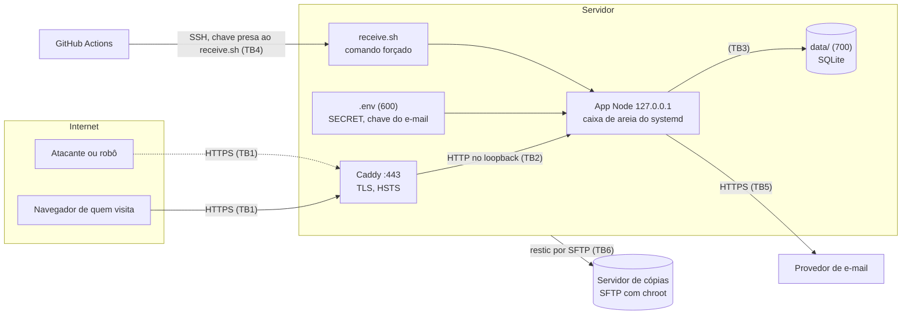

# Modelo de ameaças

[Read in English](THREAT-MODEL.md)

STRIDE, por elemento e fronteira de confiança. Versão 0.1.0, revisada em 30/10/2026. Toda mitigação diz qual arquivo a
implementa; a maioria também tem um teste que tenta quebrá-la (`test/`). O que não está mitigado aparece como tal, em
[Riscos aceitos](#6-riscos-aceitos).

## 1. O sistema

Um site pequeno num servidor Linux: o Caddy termina o TLS e repassa os pedidos para um processo Node.js na interface
de loopback. O Node serve páginas estáticas e uma API JSON (contas sem senha e um endpoint de administração), com um
único arquivo SQLite. O GitHub Actions testa cada mudança e, na `main`, entrega por SSH. As cópias vão para o GitHub
(criptografadas) ou para um segundo servidor (restic).

| Fronteira | Entre | O que atravessa |
|---|---|---|
| TB1 | Internet e Caddy | todo pedido, de qualquer pessoa |
| TB2 | Caddy e Node | os mesmos pedidos, com `X-Forwarded-For` acrescentado pelo Caddy |
| TB3 | Node e sistema operacional | acesso a arquivos, chamadas de sistema; contidos pelo systemd |
| TB4 | GitHub e servidor | versões novas do código, leitura das cópias |
| TB5 | Node e provedor de e-mail | o endereço e o código de entrada |
| TB6 | Servidor do site e servidor de cópias | dados de cópia criptografados |

## 2. Ativos

| ID | Ativo | Por que importa |
|---|---|---|
| A1 | E-mails das contas | dado pessoal (LGPD, GDPR); o identificador da conta |
| A2 | Tokens de sessão | quem tem um é a pessoa, por até 30 dias |
| A3 | Códigos de entrada | uma credencial por 10 minutos |
| A4 | `SECRET` e a chave do provedor de e-mail | sozinhos não falsificam nada, mas enfraquecem A3 e permitem mandar e-mail como o site |
| A5 | Integridade do servidor | o código e outros sites que dividam a máquina |
| A6 | Cópias | uma cópia completa de A1 |
| A7 | Disponibilidade da entrada | o momento mais movimentado é também o mais visível (um lançamento) |

## 3. Quem pode atacar

- **Visitantes anônimos e robôs** na internet: scanners, credential stuffing, spam, raspagem.
- **Uma pessoa com conta** tentando chegar aos dados de outra ou ao endpoint de administração.
- **Alguém com uma cópia do banco**: imagem de disco roubada, artefato vazado.
- **Alguém na cadeia de entrega**: action, pacote ou token do GitHub comprometido.
- **Um vizinho**: outro site no mesmo servidor, comprometido primeiro.

## 4. STRIDE

### Falsificação de identidade (Spoofing)

| ID | Ameaça | Mitigação | Situação |
|---|---|---|---|
| S1 | Adivinhar o código de entrada de alguém | 6 dígitos (10⁶), 5 tentativas por código, 5 códigos por e-mail por hora, 150 pedidos de código por IP por hora (`server/accounts.mjs`, `server/server.mjs`). No máximo 25 palpites por hora por endereço: cerca de 40.000 horas para 50% de chance. | Mitigada, testada |
| S2 | Tomar a caixa de e-mail e, com ela, a conta | A caixa é o único fator. | **Aceita**, ver R-1 |
| S3 | Roubar a sessão por XSS | Cookie `HttpOnly`; CSP sem scripts ou estilos inline; Trusted Types; o front-end só escreve `textContent` (`server/http.mjs`, `public/js/app.js`). | Mitigada, testada no navegador |
| S4 | Roubar a sessão na rede | Só HTTPS, HSTS, cookie `Secure` com prefixo `__Host-`. | Mitigada |
| S5 | Forjar o IP do cliente para escapar dos limites | Só a **última** entrada do `X-Forwarded-For` conta (a que o Caddy acrescentou), só com `TRUST_PROXY=1`; o Node escuta em 127.0.0.1; IPv6 conta por /64 (`server/http.mjs`). | Mitigada, testada |
| S6 | Se passar pelo servidor para o job de deploy (primeira conexão SSH) | A chave do servidor é um segredo salvo na instalação (`DEPLOY_KNOWN_HOSTS`), nunca `ssh-keyscan` na hora do deploy (`.github/workflows/ci.yml`). | Mitigada |
| S7 | Phishing com o domínio do site | SPF, DKIM e DMARC no domínio que envia (configuração do provedor; lista no README). | Operacional |

### Adulteração (Tampering)

| ID | Ameaça | Mitigação | Situação |
|---|---|---|---|
| T1 | Falsificação de pedido entre sites (CSRF) | Pedidos que mudam estado precisam ser JSON (um formulário não manda JSON sem um preflight que nunca é respondido), não podem vir com `Origin` de fora ou `null` nem com `Sec-Fetch-Site` de outro site, e o cookie é `SameSite=Lax` (`server/http.mjs`). | Mitigada, testada |
| T2 | Injeção de SQL | Toda consulta é um prepared statement; o único nome de coluna dinâmico vem de um mapa fixo (`server/origins.mjs`). | Mitigada, testada |
| T3 | Ler arquivos fora de `public/` | Caminho normalizado e com prefixo conferido, symlinks resolvidos com `realpath`, `%00` e escapes malformados recusados (`server/server.mjs`). | Mitigada, testada |
| T4 | Entregar uma versão maliciosa | Só o job de CI tem a chave de deploy, e só depois de testes, busca de segredos e ZAP passarem; a chave só consegue rodar o `receive.sh`, que ignora `.env` e dados no pacote, limita o tamanho a 30 MB e volta atrás se a versão nova não responder. Quem tem a chave ainda consegue entregar código que roda como o usuário do site: ver E2. | Mitigada, conferida num servidor de teste |
| T5 | Uma aplicação comprometida reescrever o próprio código | O serviço só escreve em `data/` (`ProtectSystem=strict`, `ReadWritePaths`); conferido: "Read-only file system". | Mitigada |
| T6 | Apagar ou alterar as cópias a partir do servidor do site | O usuário de cópia é só SFTP, em chroot; o root do servidor de cópias guarda 14 dias de retratos com hard links fora do alcance dele (`deploy/offsite-backup/`). | Mitigada |
| T7 | Cadeia de suprimentos | Nenhuma dependência do npm; actions presas por SHA de commit, com Dependabot; gitleaks baixado com checksum fixo; o `install-once.sh` nunca passa um script remoto para um shell root. | Mitigada |

### Repúdio (Repudiation)

| ID | Ameaça | Mitigação | Situação |
|---|---|---|---|
| P1 | "Não fui eu": sem registro das ações de administração | O único endpoint de administração hoje só lê. | **Aceita** até uma ação de administração mudar dados, ver R-3 |
| P2 | Alguém relata um erro que ninguém acha | Todo erro de servidor tem uma referência aleatória, mostrada à pessoa e registrada com o stack trace (`server/errors.mjs`). | Mitigada |
| P3 | Sem registro de acesso para investigar um incidente | De propósito: a página de privacidade promete que nenhum IP é guardado. | **Aceita**, ver R-2 |

### Divulgação de informação (Information disclosure)

| ID | Ameaça | Mitigação | Situação |
|---|---|---|---|
| I1 | Uma cópia do banco | Códigos guardados como HMAC com a chave `SECRET` (que não está no banco), tokens de sessão como SHA-256; `data/` é 700 e todo arquivo 600 (`UMask=0077`). Os e-mails ficam em claro: são necessários para mandar o código. | Mitigada, testada |
| I2 | Stack traces e versões | Erros inesperados respondem uma mensagem genérica com referência; sem `Server` ou `X-Powered-By` no Node, `header -Server` no Caddy. | Mitigada, testada |
| I3 | Arquivos esquecidos em `public/` (`.env`, `.bak`, `.map`, `.zip`) | Só uma lista de extensões é servida; arquivos ocultos nunca (`server/server.mjs`). | Mitigada, testada |
| I4 | Descobrir quem tem conta | A resposta da entrada é idêntica para endereços novos e existentes. | Mitigada, testada |
| I5 | Segredos commitados no Git | `.env` ignorado; gitleaks varre o histórico inteiro no CI. | Mitigada |
| I6 | Dados pessoais em caches ou URLs | A API responde `no-store` e `Content-Disposition: attachment`; os formulários usam `method="post"`, então nada digitado acaba numa URL, mesmo sem JavaScript (achado do ZAP, `docs/FINDINGS.pt-BR.md`). | Mitigada, testada |
| I7 | Diferenças de tempo ao conferir um código | Comparação de HMACs em tempo constante. | Mitigada |
| I8 | Credenciais nos registros | A chave de desenvolvimento que imprime códigos é recusada com `NODE_ENV=production`; erros de e-mail registram só o status. | Mitigada, testada |
| I9 | Vazamentos entre origens (Spectre, incorporação) | `Cross-Origin-Opener-Policy`, `-Embedder-Policy`, `-Resource-Policy`; `frame-ancestors 'none'`. | Mitigada |
| I10 | Ler as cópias guardadas no GitHub | Criptografadas com age para uma chave pública; a chave privada nunca passa pelo GitHub (`.github/workflows/backup.yml`). | Mitigada |

### Negação de serviço (Denial of service)

| ID | Ameaça | Mitigação | Situação |
|---|---|---|---|
| D1 | Corpos de pedido enormes | Limite de 64 KB, conferido no `Content-Length` antes de ler. | Mitigada, testada |
| D2 | Enxurrada de e-mails (custo, bloqueio do provedor, listas de bloqueio) | Limites por e-mail e por IP; fila com ritmo antes do provedor, que responde 503 quando enche (`server/mail.mjs`). | Mitigada, testada |
| D3 | Encher a tabela `origins` | No máximo 200 nomes diferentes, 30 contagens por IP por hora. | Mitigada, testada |
| D4 | Conexões lentas, enxurradas | Caddy na frente, tempos limite padrão do Node. Sem limite geral no proxy. | Parcial, ver R-5 |
| D5 | Uma versão ruim derrubar o site | Conferência de saúde depois de cada deploy, volta automática; `Restart=always`. | Mitigada, conferida num servidor de teste |

### Elevação de privilégio (Elevation of privilege)

| ID | Ameaça | Mitigação | Situação |
|---|---|---|---|
| E1 | Uma pessoa com conta chegar ao endpoint de administração | Conferido no servidor, a cada pedido, com o `ADMIN_EMAILS`. | Mitigada, testada |
| E2 | Execução de código dentro da aplicação | Caixa de areia do systemd: sem capacidades, `NoNewPrivileges`, seccomp `@system-service`, sistema somente leitura, `/tmp` e dispositivos privados, sem outras pastas pessoais, só sockets IPv4/IPv6/Unix. Exposição **1.2** (era 8.3), exigida no CI (`deploy/site.service`). | Mitigada, conferida num servidor de teste |
| E3 | A chave de deploy abrir um shell | `command="…receive.sh",restrict`: sem PTY, sem encaminhar portas, qualquer outro comando recusado. Conferido num servidor de teste. | Mitigada |
| E4 | Um site vizinho ler este | Um usuário Unix por site; `$BASE` 750, `data/` 700, arquivos 600. | Mitigada |
| E5 | A chave de cópia abrir um shell no servidor de cópias | `ForceCommand internal-sftp` num chroot do root, sem TTY nem encaminhamento. | Mitigada |

## 5. Fora do escopo

- O endurecimento do servidor em si (configuração do SSH, firewall, atualizações de segurança automáticas). Importa
  tanto quanto tudo acima; só é outro projeto.
- A configuração de TLS do Caddy (o padrão dele: TLS 1.2+, cifras modernas, certificados automáticos).
- A segurança do provedor de e-mail, do GitHub e do provedor de nuvem.

## 6. Riscos aceitos

| ID | Risco | Por que é aceito | O que o removeria |
|---|---|---|---|
| R-1 | A caixa de e-mail é o único fator de autenticação (ASVS 2.2.2) e os administradores não têm segundo fator (ASVS 4.3.1) | Entrar sem senha por e-mail é a troca escolhida para um site pequeno: nenhuma senha para vazar ou reutilizar | Passkeys (WebAuthn), administradores primeiro |
| R-2 | Sem registro de acesso, há menos para investigar depois de um incidente | A página de privacidade promete que nenhum IP é guardado | Um registro de segurança com IPs por um prazo curto e declarado, com a página de privacidade dizendo isso |
| R-3 | Sem registro de auditoria das ações de administração | O único endpoint de administração só lê | Uma tabela de auditoria só de acréscimo, assim que uma ação de administração mudar dados |
| R-4 | Quem tem a chave de deploy roda código como o usuário do site | É assim que o deploy funciona; a chave vive só num segredo de ambiente do GitHub, e a caixa de areia contém o resultado | Versões assinadas e conferidas no servidor; revisão obrigatória no ambiente `production` |
| R-5 | Sem limite geral de pedidos na frente da aplicação | Limites por endpoint cobrem os caminhos caros | Um limite no Caddy ou no provedor de nuvem |

## 7. Como foi conferido

- **Testes** (`npm test`): toda linha marcada como "testada" acima tem ao menos um teste que a ataca.
- **OWASP ZAP**: a varredura baseline roda no CI a cada push; uma varredura ativa completa foi feita antes da primeira
  versão. Os resultados e o que foi corrigido estão em [`docs/FINDINGS.pt-BR.md`](docs/FINDINGS.pt-BR.md).
- **Um servidor de teste**: `install-once.sh`, um deploy, um deploy quebrado (volta), um pacote hostil, o comando de
  cópia e os limites do comando forçado rodaram em Ubuntu 24.04 com systemd, SSH e Caddy.
- **CodeQL** (JavaScript e os workflows), **gitleaks** (histórico inteiro), **shellcheck** e
  `systemd-analyze security` com limite, no CI.
